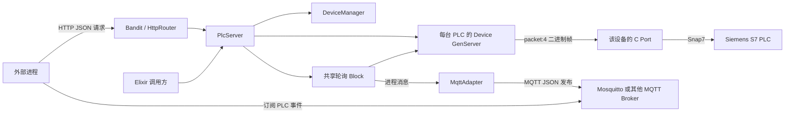

# PLC Server 系统架构

## 部署关系



HTTP 和 MQTT 适配器可分别启用。Broker 是外部进程，不在本应用监督树内。`--mock` 模式由 C Port 自行生成和存储测试数据，不连接 Snap7 或 PLC。

## BEAM 进程与监督

```text
PlcServer.Supervisor (one_for_one)
├── PlcServer.Registry                设备与 Block 的唯一注册表
├── PlcServer.BlockSupervisor         动态 Block 进程
├── PlcServer.DeviceSupervisor        动态 Device 进程
├── PlcServer.DeviceManager           运行时配置与持久化操作串行化
├── PlcServer.MqttAdapter             可选；配置的 DB 流订阅和发布
└── Bandit / PlcServer.HttpRouter     可选；HTTP 监听与路由

每个 Device 进程 ── 自己的 C Port 可执行文件
每个 Block 进程 ── 一个订阅键与多个订阅者
```

应用启动时先验证设备、MQTT 和 HTTP 配置；启动基础监督树后依次启动设备、MQTT 适配器和 HTTP 监听。若启动中途失败，停止已创建的应用监督树。动态设备通过 `DeviceSupervisor` 管理；Block 通过 `BlockSupervisor` 管理。Tortoise311 自身也启动依赖应用内的连接支持进程。

## 组件职责

| 组件 | 职责 |
| --- | --- |
| `PlcServer` | 面向 Elixir 的读写、点位转换、批量读取、订阅与设备管理入口。 |
| `PlcService.Device` | 设备请求编号、超时、Port 回复匹配、位写串行化、最近 I/O 状态。 |
| `c_src/plc_port.c` | 长度帧协议、Snap7 动态加载与连接复用、mock 行为。 |
| `PlcServer.Block` | 共享轮询、去重、错误和恢复事件、最近事件回放。 |
| `PlcServer.DeviceManager` | 运行时增删改设备、配置快照写入及失败恢复。 |
| `PlcServer.DeviceConfig` | 版本化快照的读取、校验和临时文件替换。 |
| `PlcServer.HttpRouter` | HTTP JSON 参数转换、Bearer 鉴权、调用服务与响应映射。 |
| `PlcServer.MqttAdapter` | MQTT 连接状态、配置的流订阅、最新事件缓存与重发。 |

## 关键数据流

1. **同步读写**：HTTP 或 Elixir 调用方 → `PlcServer` → `Device` → C Port → Snap7/PLC；回复沿原调用链返回。原始字节在 HTTP 中使用 Base64。
2. **订阅**：调用方 → `PlcServer.subscribe/5` 或 `subscribe_point/3` → 按订阅键取得/创建 Block → Block 周期性调用 Device → 变化事件发给订阅者邮箱。
3. **MQTT**：适配器作为内部订阅者接收 Block 事件 → 转为 JSON → Tortoise311 → 外部 Broker；断线期间只保留每个 topic 的最新事件。
4. **设备配置**：HTTP 或 Elixir 调用方 → DeviceManager → DeviceConfig 快照 → DeviceSupervisor 启停设备；Block 通过设备 ID 查找新的 Device。

## 状态归属与故障边界

设备进程保存请求等待表、位写队列和最近 I/O；C Port 保存 Snap7 会话，mock 时还保存模拟写入数据。Port 重启后，这些连接或 mock 写入状态会丢失。Block 保存本流最近数据、错误、事件及订阅者；Block 重建后生成新的 `stream_id`。MqttAdapter 的最新事件缓存只存在内存，重启后需依靠重新订阅获得快照或下一次轮询结果；Broker retained 消息由 Broker 独立保存。

设备监督器重启 Device 不会重启其他设备。Block 退出不会直接影响 Device，MQTT 适配器监控 Block 并尝试重新订阅；普通 Elixir 订阅者需自行处理 Block 退出。HTTP 监听故障由应用监督器重启，Broker 故障由 MQTT 客户端重连机制处理。

## 配置入口

- `config :plc_server, :devices` 或旧版 `PLC_HOST`、`PLC_ID`、`PLC_RACK`、`PLC_SLOT`。
- `:device_config_path` 或 `PLC_DEVICE_CONFIG_PATH`；默认工作目录下 `plc_devices.term`，快照优先于静态配置。
- `config :plc_server, :mqtt`；未配置不启动，具体字段见 [interfaces.md](interfaces.md)。
- `config :plc_server, :http`；未配置不启动，具体字段见 [http-api.md](http-api.md)。
